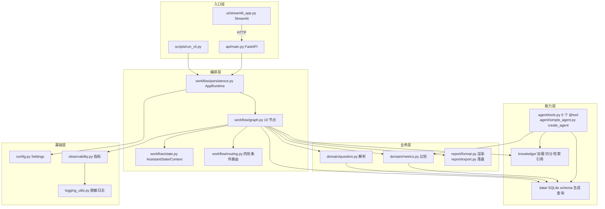
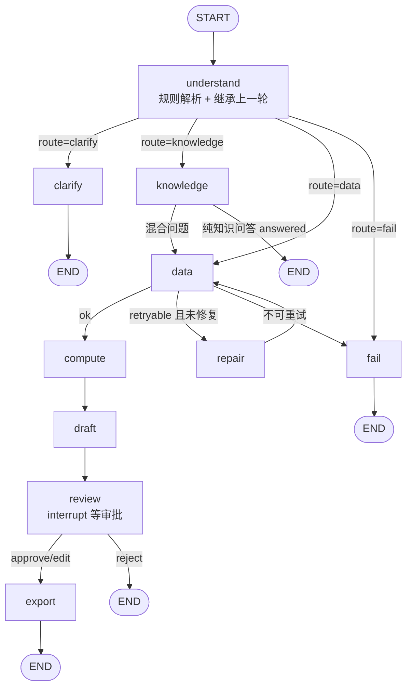
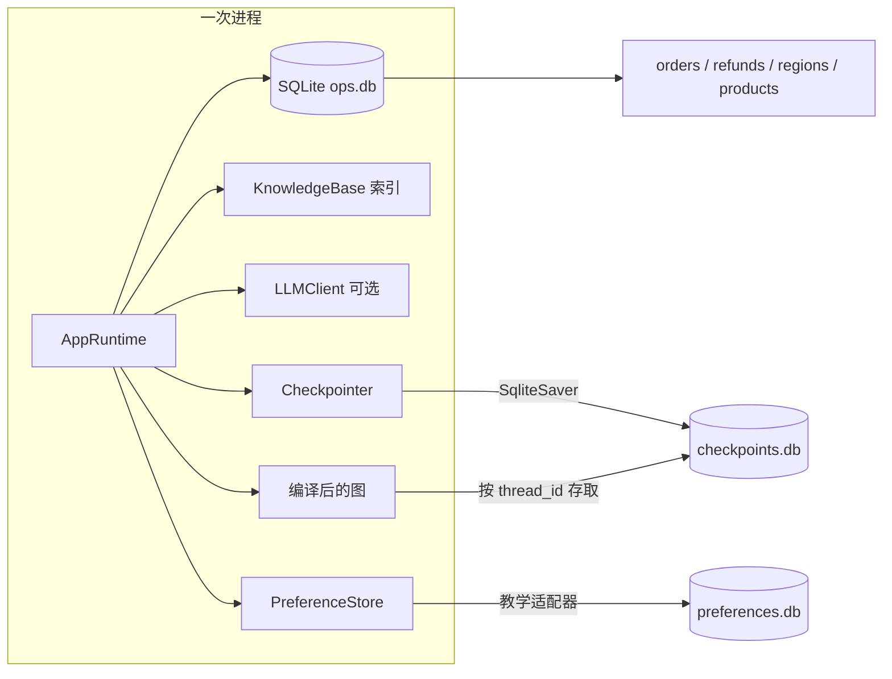
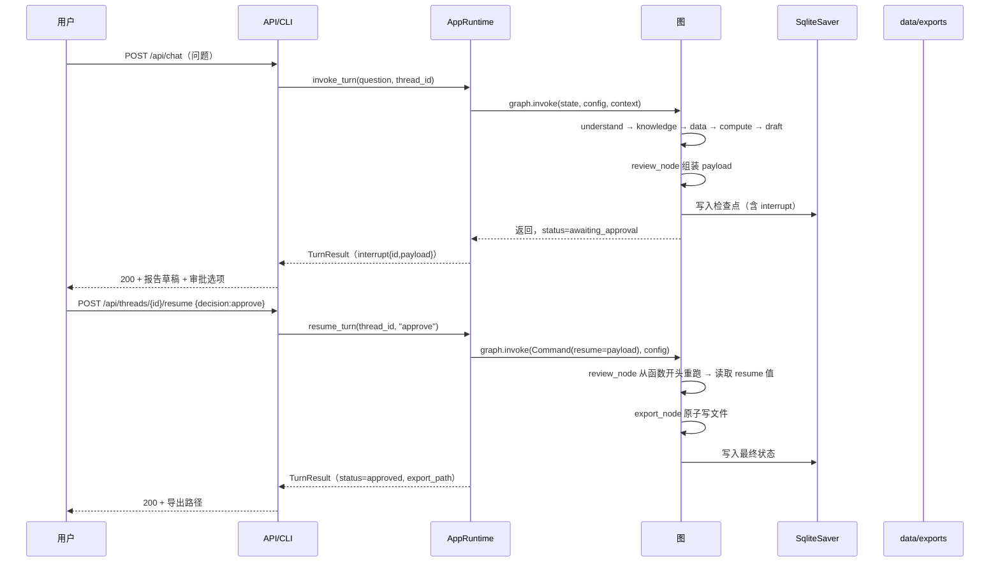
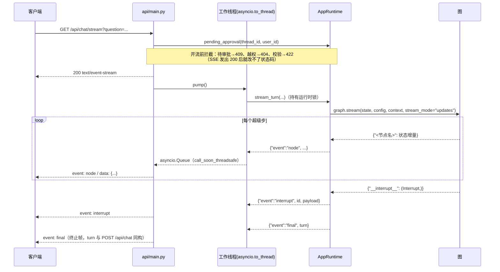
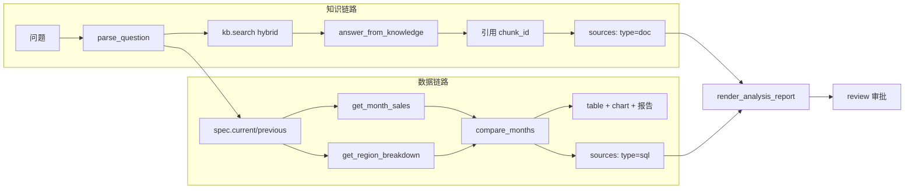

# 架构说明

本文回答四个问题：**系统由哪些层组成**、**一轮问答在图里怎么走**、**状态存在哪**、**人工审批如何暂停与恢复**。

> 事实基线：代码路径与函数名以 `ops-assistant/src/ops_assistant/` 当前文件为准；本文与源码不一致时以源码为准备。
> 诚实声明：初稿编写环境无法启动 Python 进程，本文的图与流程最初是**读代码画出来的**；2026-10-19 审查已在 Linux 沙箱实测运行整条链路（含审批中断/恢复、重启恢复），图的走向与实测轨迹一致（understand → knowledge → data → compute → draft → review 中断 → export）。

## 1. 模块分层

要点：

- **入口层不含业务逻辑**：CLI/API/UI 都只调 `AppRuntime`，保证三种入口行为一致。
- **编排层不碰 SQL**：`nodes.py` 调 `queries`/`metrics`/`qa`，不自己拼 SQL（展示用 SQL 常量除外，见限制）。
- **能力层可单独使用**：`data`、`knowledge`、`domain` 都能在 pytest 里独立测。

## 2. 一轮问答的图路由

四处条件路由（`routing.py` 和 `graph.py`）：

| 路由函数 | 判定依据 | 去向 |
| --- | --- | --- |
| `route_after_understand` | `status` 是否为终态；`route` 是否在允许集合 | `clarify` / `knowledge` / `data` / `fail` |
| `graph.py` 的 knowledge 路由 | 纯知识问答已 answered | `end` / `data` |
| `route_after_data` | 最近一条 `node="data"` 的 trace 的 `ok` / `retryable`；已修复次数 | `compute` / `repair` / `fail` |
| `route_after_review` | 审批结论（approve/edit → export；reject → 结束） | `export` / `end` |

预算（`state.budget`，默认 `steps=12`、`tool_calls=8`）：每个节点进入前 `_guard_step`，工具调用前 `_guard_tools`；超限写 `status="budget_exceeded"`，由路由送到 `fail`，**不抛 GraphRecursionError**。

## 3. 状态、检查点、线程、Store、运行时上下文

这五者最容易混，对照表：

| 概念 | 存在哪 | 生命周期 | 本项目用法 | 官方对应 |
| --- | --- | --- | --- | --- |
| `AssistantState` | 图执行期间在内存；每个 superstep 合并 | 一轮/多轮（写入检查点后跨轮） | 问题、spec、检索结果、计算、报告、trace、errors、budget | LangGraph State |
| `Checkpointer` | `data/checkpoints.db`（演示）或内存（测试） | 跨进程（SqliteSaver） | `thread_id` 维度的图快照与中断 | LangGraph checkpointer |
| `thread_id` | 状态键 / 配置里的 `configurable.thread_id` | 会话级 | 多轮追问、审批恢复、导出文件命名 | LangGraph thread |
| `Store` | `data/preferences.db` | 跨会话 | `amount_unit` / `default_dimension` 偏好 | LangGraph Store（本项目用 SQLite duck-type 适配器，**教学简化**） |
| `Runtime Context` | 调用时注入，不写检查点 | 单次 `invoke` | 连接、知识库、模型、偏好、指标集合 | LangGraph Runtime Context |

**为什么 Store 适配器是教学简化**：官方 Store 有命名空间、批量检索等语义；`PreferenceStore` 只实现 `get/put/search/all_for_user` 这几个被用到的鸭子类型方法，行为与官方实现不保证一致。真正的生产项目应使用官方 Store 实现（或数据库 + 明确的接口）。

## 4. 人工审批（HITL）时序

关键约束（与 `workflow/nodes.py` 一致）：

1. `review_node` 在 `interrupt()` 之前**只做纯读/纯算**，不写文件、不写库；
2. 恢复时该节点从头重跑，所以副作用必须放在 `export_node`；
3. `export_node` 用临时文件 + `os.replace`，文件名为 `report-<thread_id>-<report_id>.md`；
4. 重复 `approve`：`resume_turn` 检测到无待处理中断且已导出，直接返回同一结果（幂等）；
5. 换进程后仍可恢复的前提是 `SqliteSaver`（`InMemorySaver` 重启即丢）。

### 4.1 流式路径（同一个图，另一种送达方式）

`GET /api/chat/stream`（SSE）与 `POST /api/chat` 跑的是**同一张图、同一套审批语义**，区别只在"进度怎么送达"：

两个必须知道的约束：

1. **`RLock` 按线程归属**：`stream_turn` 在整个流期间持锁（与 `invoke_turn` 同样的串行化保证）。Starlette 消费同步生成器时会在线程池里逐个 `next()`，相邻两次可能落在不同线程，直接交给 `StreamingResponse` 会在释放锁时抛 `RuntimeError`。所以这里用单独一个工作线程迭代生成器，锁的获取与释放都在同一线程；
2. **客户端断开不中止工作流**：本轮会跑完并写入检查点，避免留下半截状态，只是后续帧不再发送。

审批仍走 `POST /api/threads/{id}/resume`：流式只送到 `interrupt` 为止，报告不会因为"流完了"就落盘。

## 5. 数据与知识两条链路

两条链路的产物都进入 `sources`，报告第 8 节把它们逐条列出——这是"数字可追溯"的实现方式：**报告里的每个数字都能指回一条 SQL 或一个知识块**。

## 6. 部署形态与已知约束

- **单进程、单 worker**：`AppRuntime` 持有 SQLite 连接与一把 `threading.Lock`，图调用串行；不要用 `uvicorn --workers 2`。
- **本地优先**：导出目录 `data/exports/`；无外网依赖（模型可选）。
- **可观测**：结构化日志（脱敏）+ `MetricsCollector`（模型调用/工具调用/token/错误）+ `TurnResult.trace`。
- **不做的事**：多租户鉴权、分布式队列、真实数据接入、模型微调。

更完整的限制与未验证项见 [limitations.md](limitations.md)，验证命令见 [verification.md](verification.md)。
