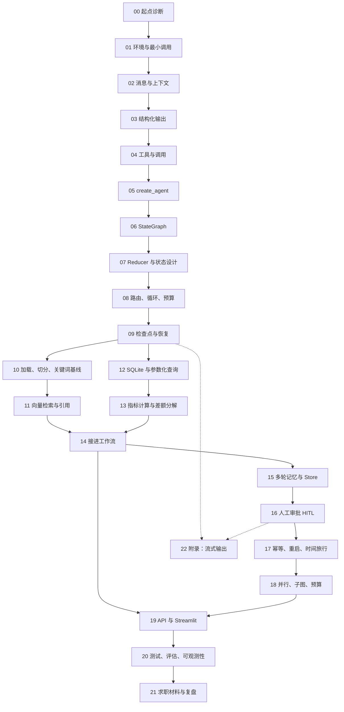

# 《经营数据分析与知识库智能助手》教程总览

> **当前入口（2026-10-20）**：基础顺序仍为 00–21，22 为流式附录，完成后必须做 [23：契约与版本化验收](23-契约与版本化验收.md)。本轮 220 项测试、20 条确定性评估及 23 个实验脚本通过；UI 与三进程恢复见 [验证记录](../docs/verification.md)。旧正文中的 2026-10-19 数字是历史结果。审批/导出/API 的当前契约以单元 23 与代码为准。
>
> 学习主线：LangChain 提供模型、消息、工具、`create_agent` 和 middleware；LangGraph 提供 StateGraph、状态合并、分支、持久化与中断。`create_agent` 底层使用 LangGraph；本项目主产品路径选择显式工作流，另保留可选模型 Agent 入口。无 key 可完成工程验收，有 key 后仍须单独补模型能力与效果评估。

这是一套**以项目为主线**的 LangChain / LangGraph 教程：22 个学习单元（另加单元 22 附录：流式输出），每单元 30–60 分钟，学完的产物只有一个——你能独立讲清楚、改得动、测得了、演示得出的 `ops-assistant/` 项目。

> **诚实声明（先读）**
> - 这不是"7 天精通"课程，也不承诺就业。它承诺的是：每个单元都有**可验收的产物**与**可复现的命令**。
> - **验证状态（2026-10-19 更新）**：初稿编写环境无法启动 Python 进程（`pwsh` 返回 `0xC0000142`），当时所有输出都写成"预期（未在本环境执行）"。2026-10-19 的审查在 Linux 沙箱（Python 3.11.2、uv 0.13.1、langgraph 1.2.16、langchain 1.4.6，与 PyPI 当日最新版一致）完成了整体验证：**19 个单元实验脚本全部运行通过（退出码 0）**、项目测试 **176/176 通过**、`ruff check .` 无告警、确定性评估 **14/14 状态匹配**、`bootstrap.py` / CLI（含审批与幂等重审）/ FastAPI（9 组端点）/ Streamlit 均实际运行验证。各单元第 6 节的主路径标题已改为"实测运行通过"；"有密钥时""失败与边界实验"等未在本环境复现的条目仍保留"预期"标记。**学习纪律不变：你必须在自己机器上复跑并记录实际输出，不要抄教程里的输出当自己的结果。**
> - 单元里的代码是**内嵌在正文中**的完整代码；`教程/实验/` 目录下已随本次审查放入从正文提取的实验脚本（提取与运行记录见 `docs/verification.md`），仍建议你亲手照第 5 节敲一遍再对照。
> - 仓库根目录的 `LangGraph智能体开发完整教程.md` 是上一轮的单文件草稿，**仅作参考，不作为本项目验收证据**。

---

## 1. 你会做出什么

一个能在浏览器里用的经营分析助手：

- 问："2026 年九月销售额比八月变化多少？按地区分解差额，并说明销售额是否扣除了退款。"
- 它：解析口径 → 检索知识库（退款归属、指标定义）→ 查 SQLite → 程序算差额 → 生成带来源的 Markdown 报告 → **停下来等你审批** → 你批准后落盘 `data/exports/report-<thread_id>-<report_id>.md`。
- 追问："那华东地区呢？" → 沿用上一轮的期间，只算华东。
- 换一个进程重启服务 → 会话状态还在，可以继续审批。

关键设计：**数字全部由程序算，模型只做可选润色且不许出现数字**。没有 API Key 也能跑通全链路。

## 2. 前置与学习契约

| 项目 | 要求 |
| --- | --- |
| Python | 3.11+，会用函数、`dict`/`list`、`try/except`、类型标注 |
| 命令行 | 会在 PowerShell 里 `cd`、运行命令、读报错 |
| SQL | 知道 `SELECT` / `WHERE` / `GROUP BY` 即可；单元 12 会补 |
| 英语 | 能读官方文档标题与代码块；中文讲解为主 |
| 硬件 | 普通笔记本；**不需要 GPU**（默认用确定性哈希向量，不下载模型） |
| 模型 | **可选**。有 Key 时可以开启润色与 Agent 路线；没有也能完成全部验收 |

学习契约（建议写在你的笔记第一页）：

1. 每个单元先读"验收标准"，再决定要花多少时间；
2. "修改练习"必须动手改一次，改坏一次；
3. 不许跳过"失败与边界实验"——面试问的几乎都是边界；
4. 每单元结束用"复盘问题"自测，答不出来就回到对应小节；
5. 记录你实际运行的命令与输出，不要抄教程里的"预期输出"当自己的结果。

## 3. 学习路径与依赖关系



- **10 与 12/13 可以并行**：一条是知识线，一条是数据线，单元 14 汇合。
- **15–18 是"生产化"四连**：记忆 → 审批 → 恢复 → 并发/预算。
- **19–21 是交付**：界面、评估、面试。
- **22 是附录（选修）**：流式输出。学完 09/16 之后随时可插队；不学也不影响主线验收。

## 4. 六个阶段与验收产物

| 阶段 | 单元 | 阶段结束时你应该能 | 验收产物 |
| --- | --- | --- | --- |
| 一、起步 | 00–01 | 装好环境、跑通一次最小模型调用（或无 Key 的降级路径） | 一个能运行的 `01_min_call.py` |
| 二、单 Agent | 02–05 | 讲清消息/提示词/工具/结构化输出，能写出第一版问答助手 | `05` 的实验脚本 + 能说明"何时不需要 Agent" |
| 三、图编排 | 06–09 | 自己画出状态图，理解 reducer、路由、预算、检查点 | 手写一个三节点图并中断恢复 |
| 四、知识与数据 | 10–14 | 讲清检索与 SQL 口径，理解"数值必须程序算" | 检索实验 + 指标对账 + 接入工作流 |
| 五、生产化 | 15–18 | 多轮、Store、审批、重启恢复、预算与失败出口 | 能演示"拒绝审批不落盘""重启后继续审批" |
| 六、交付 | 19–21 | 起 API/UI、跑测试与评估、讲清取舍与限制 | 一次 5 分钟完整演示 |

## 5. 22 个单元 + 1 个附录一览

| # | 单元 | 核心问题 | 建议时长 |
| --- | --- | --- | --- |
| 00 | 起点诊断 | 我该跳过什么？这份课程怎么用？ | 30–40 min |
| 01 | 环境、uv 与最小模型调用 | 依赖怎么装？没有 Key 能学到什么程度？ | 45–60 min |
| 02 | 消息、提示词与上下文 | System/History/工具消息各管什么？上下文为什么会爆？ | 40–50 min |
| 03 | 结构化输出与业务校验 | 模型输出怎么变成可信数据？校验放在哪一层？ | 45–60 min |
| 04 | 工具定义、调用请求与执行 | "模型要调工具"和"真的执行"差在哪？ | 45–60 min |
| 05 | create_agent：第一版问答助手 | 什么场景用 Agent，什么场景写死流程更好？ | 50–60 min |
| 06 | StateGraph：状态、节点、边 | 图的最小构成是什么？节点返回什么？ | 45–60 min |
| 07 | Reducer、MessagesState 与状态设计 | 为什么我的消息被覆盖了？状态字段怎么设计？ | 45–60 min |
| 08 | 条件路由、循环、预算与失败退出 | 怎么保证图不会转圈转到崩溃？ | 50–60 min |
| 09 | Checkpointer、thread 与恢复 | 会话状态存哪？重启后为什么读不到？ | 45–60 min |
| 10 | 文档加载、切分与关键词基线 | 为什么先做关键词检索？切分参数怎么选？ | 45–60 min |
| 11 | 向量检索、引用与"资料不足" | 哈希向量不是语义模型，那它能干什么？ | 45–60 min |
| 12 | SQLite 数据模型与参数化查询 | 表怎么设计？为什么绝不能拼 SQL 字符串？ | 45–60 min |
| 13 | 指标计算、退款归属与差额分解 | 退款算哪个月？零基数怎么办？地区差额怎么对账？ | 50–60 min |
| 14 | 把检索与数据接进工作流 | 哪些步骤该写死，哪些该让模型选？ | 50–60 min |
| 15 | 多轮记忆、Store 与 Runtime Context | State/Checkpointer/thread/Store 到底有什么区别？ | 50–60 min |
| 16 | 人工审批：interrupt 与恢复 | 中断后节点为什么会重跑？副作用怎么办？ | 50–60 min |
| 17 | 幂等、重启恢复与时间旅行 | 重复审批会导出两份文件吗？怎么回滚？ | 45–60 min |
| 18 | 并行、子图与执行预算 | 什么时候该并行？预算怎么设计才不误伤？ | 50–60 min |
| 19 | FastAPI 与 Streamlit 界面 | 接口怎么设计？UI 刷新怎么不丢状态？ | 50–60 min |
| 20 | 测试集、评估与可观测性 | 怎么证明它是对的？确定性 vs 模型行为怎么分开评？ | 50–60 min |
| 21 | 求职材料、演示与复盘 | 5 分钟怎么讲？被追问边界怎么答？ | 45–60 min |
| 22 | 附录：流式输出 stream_mode（选修） | 界面要进度反馈时怎么办？invoke 和 stream 差在哪？ | 45 min |

## 6. 每个单元的结构（固定 10 节）

所有单元都按同一结构写，方便你按需跳读：

1. 学习目标与前置（含**可跳过条件**）
2. 官方文档与阅读问题（含链接与**核对日期 2026-10-19**）
3. 通俗解释与精确技术定义
4. 在主项目中的位置（对应哪个文件/节点/工具）
5. 文件、完整代码、配置与命令
6. 预期输出与关键状态变化（**标注"预期，未在本环境执行"**）
7. 修改练习（≥2 个，含"改坏它"）
8. 失败与边界实验（≥3 个）
9. 验收标准（可勾选）
10. 复盘问题与参考答案、下一步

事实标签统一用四种：**官方事实** / **教学简化** / **项目设计选择** / **未验证**。

## 7. 术语表（中英对照）

| 中文 | 英文 | 在本项目里的含义 |
| --- | --- | --- |
| 消息 | Message | `SystemMessage` / `HumanMessage` / `AIMessage` / `ToolMessage` |
| 工具 | Tool | 用 `@tool` 装饰的函数；模型只能"请求调用"，执行由程序做 |
| 结构化输出 | Structured output | `with_structured_output(PydanticModel)`，把自由文本变成可校验对象 |
| 状态图 | StateGraph | LangGraph 的编排对象；节点是函数，边决定下一步 |
| 状态 | State | 节点之间传递的字典；带 reducer 的字段会"合并"而不是"覆盖" |
| 归约器 | Reducer | 决定同一字段多节点写入时如何合并（如 `add_messages`、`operator.add`） |
| 条件边 | Conditional edge | 由函数返回值决定下一个节点 |
| 检查点 | Checkpointer | 持久化图状态；`InMemorySaver` 重启即丢，`SqliteSaver` 可恢复 |
| 线程 | thread_id | 一段会话的标识；同 thread 才有历史与可恢复状态 |
| 中断 | interrupt | 在图中间暂停，等待外部输入（本项目用于人工审批） |
| 运行时上下文 | Runtime Context | 通过 `graph.invoke(..., context=...)` 注入的依赖（连接、知识库、模型） |
| 存储 | Store | 跨会话/跨线程的长期记忆（本项目用 SQLite 适配器 `PreferenceStore`） |
| 检索增强 | RAG | 先检索知识块，再让模型基于给定资料回答并给引用 |
| 分块 | Chunk | 检索的最小单位；本项目 400 字/60 重叠，id 形如 `01_指标口径#3` |
| 引用 | Citation | 答案后附 `[chunk_id]`，必须能在索引里查到 |
| 幂等 | Idempotent | 同一操作重复执行结果一致（本项目：重复审批返回同一导出路径） |
| 预算 | Budget | 单轮允许的最大步数与工具调用数，超限走失败出口 |
| 可观测性 | Observability | 轨迹、耗时、工具计数、错误码；本项目全部落结构化日志 |

## 8. 怎么配合项目源码学

教程与源码是**互相印证**的关系，不是两份独立材料：

| 教程单元 | 打开这个文件对照 |
| --- | --- |
| 04、05 | `src/ops_assistant/agent/tools.py`、`simple_agent.py` |
| 06–09 | `src/ops_assistant/workflow/{state,routing,graph,persistence}.py` |
| 10、11 | `src/ops_assistant/knowledge/*.py` |
| 12、13 | `src/ops_assistant/data/{schema.sql,queries.py}`、`domain/metrics.py` |
| 14 | `src/ops_assistant/workflow/nodes.py` |
| 15–18 | `workflow/persistence.py`、`report/export.py` |
| 19 | `api/main.py`、`ui/streamlit_app.py` |
| 20 | `tests/`、`eval/`、`docs/verification.md` |
| 22（附录） | `workflow/persistence.py` 的 `invoke_turn`（对照它想 `stream` 的差异） |

## 9. 学习记录怎么记

建议每单元在 `notes/`（自建）留 3 行：

```text
单元 NN｜日期｜实际用时
我改了什么：
我踩了什么坑（报错原文 + 最终原因）：
验收：通过 / 部分通过 / 未通过（原因）
```

不做这一步，三周后你只会记得"好像学过"。

## 10. 相关文档

- 安装/配置/运行/测试/演示：[ops-assistant/README.md](../ops-assistant/README.md)
- 架构与图路由：[docs/architecture.md](../docs/architecture.md)
- 演示台词与失败路径：[docs/demo-script.md](../docs/demo-script.md)
- 已知限制与未验证项：[docs/limitations.md](../docs/limitations.md)
- 面试自测：[docs/interview.md](../docs/interview.md)
- 验证记录（必读，说明哪些没跑过）：[docs/verification.md](../docs/verification.md)
- 全部交付物清单：[交付清单.md](../交付清单.md)
